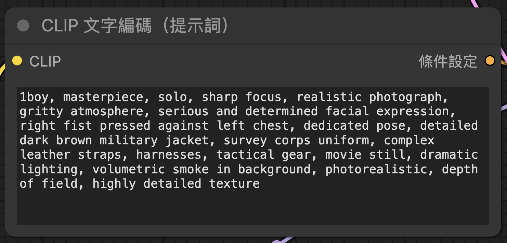
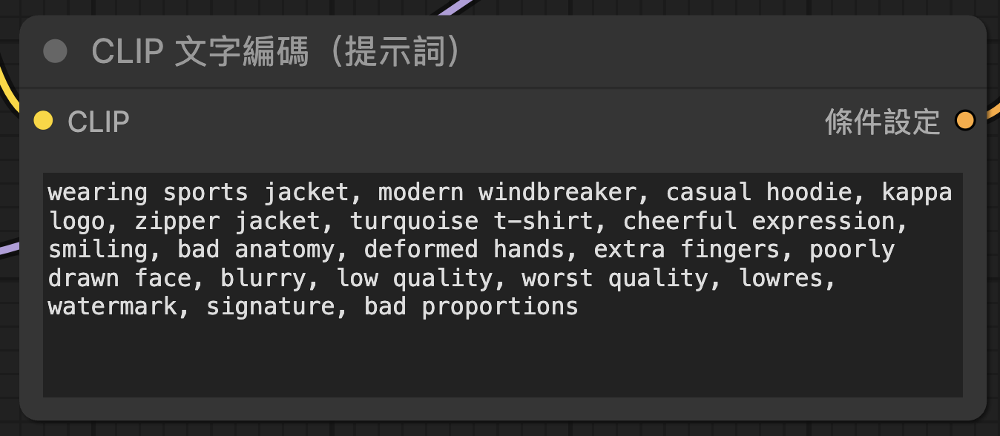
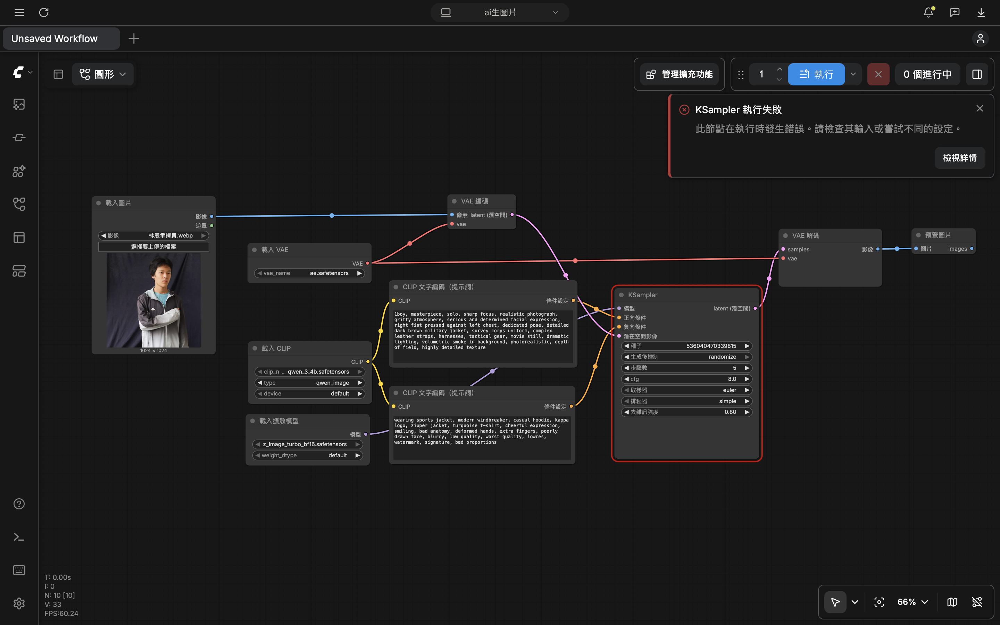

<h1>ComfyUI生成圖片與心得 1152021林辰聿</h1>
    <h2>原圖</h2>
    
    <h2>生成圖片</h2>
    
很遺憾沒生成成功

    <h2>正提示詞</h2>
    
    <h2>負提示詞</h2>
    
    <h2>流程圖</h2>
    
    <h2>心得</h2>
    
這次使用ComfyUI生成圖片的過程讓我感受到了很多辛苦，嘗試了半天調整了各種設定都沒能成功，結果最後疑似是因為電腦設備無法負荷而導致算力撐不住（或者有可能是我哪個設定沒調好），整體而言沒能生出圖片是我的遺憾，只能希望以後能有更好的結果。

</body>